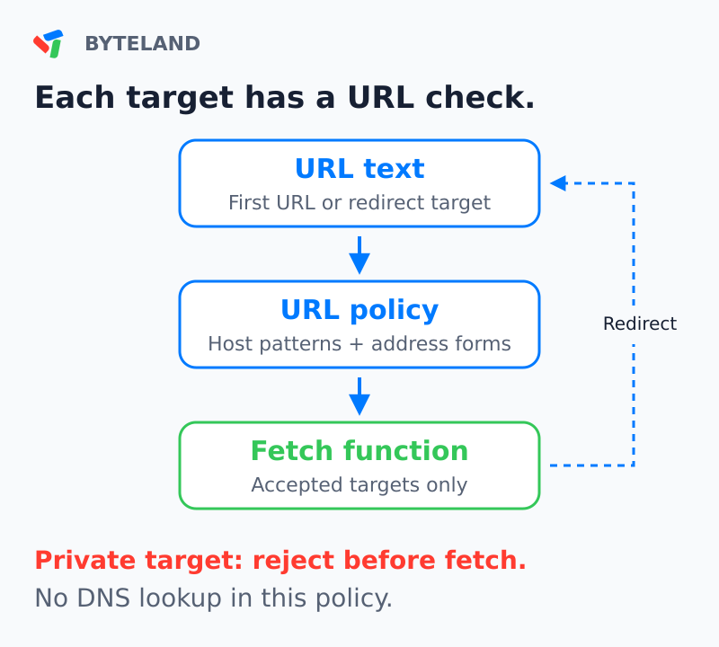
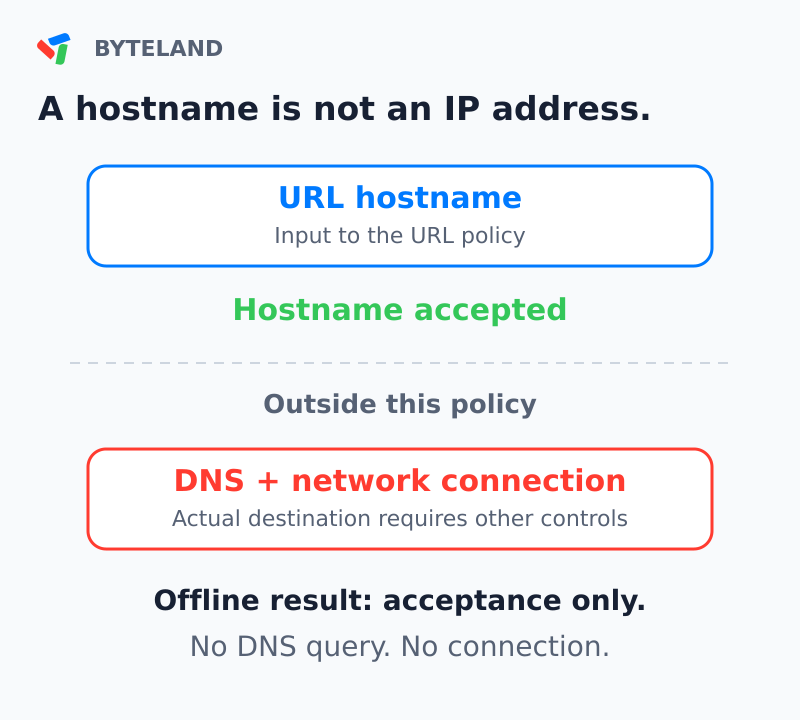
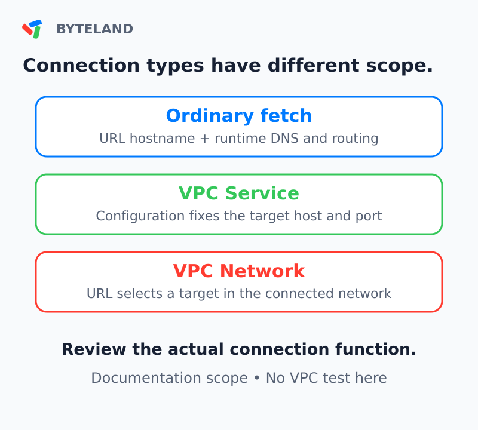
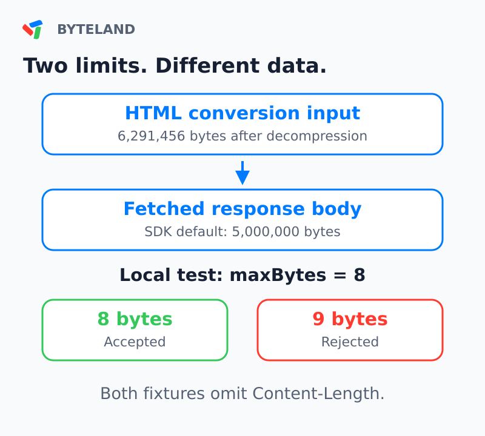

<figure style={{margin: "0 0 32px"}}>
<video controls playsInline preload="metadata" aria-label="Cloudflare agent URL policy: narrated test overview" aria-describedby="test-video-caption" poster="/posts/2026-10/cloudflare-agent-url-policy/poster.png" style={{display: "block", width: "100%", height: "auto", aspectRatio: "16 / 9", borderRadius: "16px"}}>
  <source src="/posts/2026-10/cloudflare-agent-url-policy/agent-url-policy.mp4" type="video/mp4" />
  <track kind="subtitles" src="/posts/2026-10/cloudflare-agent-url-policy/captions.en.vtt" srcLang="en" label="English" default />
  <track kind="subtitles" src="/posts/2026-10/cloudflare-agent-url-policy/captions.zh-Hans.vtt" srcLang="zh-Hans" label="简体中文" />
  <track kind="subtitles" src="/posts/2026-10/cloudflare-agent-url-policy/captions.zh-Hant.vtt" srcLang="zh-Hant" label="繁體中文" />
  <track kind="subtitles" src="/posts/2026-10/cloudflare-agent-url-policy/captions.ja.vtt" srcLang="ja" label="日本語" />
  Your browser does not support embedded video. <a href="/posts/2026-10/cloudflare-agent-url-policy/agent-url-policy.mp4">Download the video</a>.
</video>
<figcaption id="test-video-caption" style={{marginTop: "12px", fontSize: "0.875rem", lineHeight: 1.6}}>The video shows the test scope.</figcaption>
</figure>

Cloudflare added a `web_fetch` tool in `agents@0.28.0`. Its release date is October 9, 2026, at 14:05 UTC. We operated the published fetch source with local responses. All 27 results agreed with the specified results.

The tests answer three useful questions. Which URLs does the source reject? What occurs after a redirect? Can the source stop an oversized response without a size header?

They also show an important limit. The URL policy does not resolve Domain Name System (DNS) names. A permitted hostname gives no data about the network destination. The runtime and its network configuration need their own examination.

## What is new, and what is background

Version 0.28.0 adds the new web fetch tool and browser tools. The web fetch documentation has a Beta label. Its application programming interface (API) can change. This article examines the direct web fetch source, not the browser tools. See the [release notes](https://github.com/cloudflare/agents/releases/tag/agents%400.28.0).

Earlier Cloudflare code contained an experimental Think fetch tool with an allowlist. Thus, URL restrictions are not new to all Cloudflare agent code. Our subject is this published source and its shared URL policy.

Another October 9 change makes this test more useful. Cloudflare changed its Markdown for Agents conversion to a streaming process. Converted responses no longer contain a `Content-Length` header. We added response-limit cases for that condition. The change is in a different service. It is not a change to this package's byte limit. See the [conversion announcement](https://developers.cloudflare.com/changelog/post/2026-10-09-markdown-for-agents-in-process-conversion/).

## Examine the URL before each fetch call

The source first puts the URL into a standard form. It rejects unsupported protocols, URL user information, and specified private or local host forms. Optional host lists add restrictions. A blocked host stays blocked when an allowed-host entry also includes it.

The source uses manual redirect processing. It examines the next target before another fetch call. A redirect to a private address stops at that point. A redirect from HTTPS to HTTP also stops. These controls are in the [URL policy](https://github.com/cloudflare/agents/blob/48d9c36f5f1ff18a91fbf0659b9a8e026d1cac43/packages/agents/src/web/url-policy.ts) and [direct source](https://github.com/cloudflare/agents/blob/48d9c36f5f1ff18a91fbf0659b9a8e026d1cac43/packages/agents/src/web/fetch/source.ts) at the release commit.



The HTTPS rule has a narrow meaning. Our initial HTTP URL was accepted. The rejected case started with HTTPS and then redirected to HTTP. An application that needs HTTPS for every request must add that requirement.

Host patterns also need care. The pattern `*.example.com` did not include the apex domain `example.com`. It did not accept `docs.example.com.evil.test`. Add the apex domain explicitly when it is necessary.

## Twenty-seven offline cases

We used the actual npm package, version 0.28.0. Its archive SHA-512 value agreed with the registry value. The environment was Node.js 24.19.0 on Linux x64.

`createDirectWebFetch` accepts a supplied fetch function. Our function supplied responses from memory. The test replaced the global fetch function with an error. The conversion function also produced an error if called. No network request, DNS query, model request, or conversion occurred.

The table groups selected results. A fetch call means a call to our local function. It does not mean a network connection.

| Local test | Result | Fetch calls |
| --- | --- | ---: |
| Public hostname, text response | Accepted | 1 |
| Loopback, private IPv4, or localhost | Rejected | 0 |
| Decimal or IPv4-mapped loopback | Rejected | 0 |
| Public URL, then private redirect | Rejected at next target | 1 |
| Two public URLs, then private redirect | Rejected at third target | 2 |
| HTTPS URL, then HTTP redirect | Rejected at next target | 1 |
| Initial HTTP URL | Accepted | 1 |
| Public redirect beyond allowed hosts | Rejected at next target | 1 |
| Allowed relative redirect | Accepted | 2 |
| Public hostname, no DNS lookup | Accepted | 1 |
| Eight-byte body, eight-byte limit | Accepted | 1 |
| Nine-byte body, no size header | Rejected at eight-byte limit | 1 |

Other cases included a redirect loop, a zero redirect limit, unsupported protocols, and host-list precedence. An allowlist entry did not remove the private-host rule. The explicit `allowPrivateHosts: true` option did remove it in our local test.

To do the test with the supplied package, enter:

```sh
cd experiment
node offline-webfetch.mjs
```

The result was `27/27 passed`. Real fetch attempts and conversion attempts were both zero. The package includes the commands, expected results, observed results, and integrity data.

## Redirects can change request context

Cloudflare's Workers Request documentation identifies another reason to control redirects. Automatic redirect processing can forward request headers to a different hostname. This includes `Cookie` and `Authorization` headers. See the [Request API warning](https://developers.cloudflare.com/workers/runtime-apis/request/).

The tested source made GET requests with manual redirect processing. Our test examined every supplied request. None contained a cookie or an authorization header. This is evidence about this source and these options. It gives no data about the behavior of a custom source that copies incoming headers.

For an agent that reads documentation, avoid unnecessary request headers. Examine each redirect target before you supply any destination-specific credentials.

## DNS needs a connection-level decision

A hostname is text. DNS can supply one or more IP addresses for that text. The shared URL policy examines the hostname without those addresses. Cloudflare states this limit in the [versioned documentation](https://github.com/cloudflare/agents/blob/48d9c36f5f1ff18a91fbf0659b9a8e026d1cac43/docs/agents/fetch-the-web.md).

Our fixture used a hostname that contains a loopback address in its text. The source accepted it and called our local function. We did not resolve the name. We did not connect to a private service. This case shows a hostname decision, not a deployed vulnerability.



OWASP recommends application controls and network controls for server-side request forgery (SSRF). For known destinations, it recommends an allowlist. Its DNS guidance includes all returned IPv4 and IPv6 addresses. See the [SSRF prevention guidance](https://cheatsheetseries.owasp.org/cheatsheets/Server_Side_Request_Forgery_Prevention_Cheat_Sheet.html).

A DNS check alone is insufficient when the connection can use a later, different answer. DNS rebinding uses changes in DNS answers. The validated address and the actual connection must agree. TLS hostname verification must also stay correct. This is a deployment design requirement, not a result from our offline test.

## The Workers connection type matters

Do not use one statement about Workers for every connection type. Ordinary Worker fetch and a configured private-network binding have different capabilities.

Cloudflare documents hostname-based destinations for ordinary fetch. Workers VPC bindings can connect to private services. The following details are deployment background, not new features from the October 9 agent release. See [Workers known issues](https://developers.cloudflare.com/workers/platform/known-issues/) and the [VPC binding API](https://developers.cloudflare.com/workers-vpc/api/).

| Connection type | What selects the destination? | Review question |
| --- | --- | --- |
| Ordinary Worker fetch | URL hostname, with runtime DNS and routing | Which runtime restrictions are applicable? |
| VPC Service binding | Configured service host and port | Is this service the intended destination? |
| VPC Network binding | URL destination within the connected network | Which network routes can the application use? |

A VPC Service uses its configured connection target even when the fetch URL has a different host. That URL host supplies the Host header and TLS server name. A VPC Network gives wider routing scope. Its URL selects the destination among services that the bound network can connect to. Workers VPC is in Beta.



The tested package does not automatically select a VPC binding. If you supply a custom source or connection function, examine its routing behavior. A URL rule cannot describe a target that comes from a different configuration field. We did not deploy or test either VPC binding.

## Streaming changes where the size check occurs

The October 9 Markdown change removes the size header because the converted body is streamed. The conversion limit also increased from 2 MiB to 6 MiB of decompressed HTML. Token-count headers are no longer supplied. Applications that need token counts must calculate them. See the [current Markdown reference](https://developers.cloudflare.com/fundamentals/reference/markdown-for-agents/).

These values refer to different stages:

| Limit | Measured data | Value |
| --- | --- | --- |
| Markdown for Agents conversion | Decompressed HTML input | 6,291,456 bytes |
| Direct fetch source default | Received response body | 5,000,000 bytes |
| Our response-limit fixture | Local text response body | 8 bytes |

The larger conversion input limit does not increase the fetch source limit. HTML input size and converted Markdown size can differ. Neither byte count is a model token count.



Our eight-byte body was accepted. A nine-byte body produced `web_fetch_too_large`. Neither response contained `Content-Length`. A third case declared nine bytes and produced the same error. Thus, the tested source rejected oversized bodies with and without that header.

This test does not measure Cloudflare's conversion service. All bodies came from memory. It tests the published source's response reader under a relevant input condition.

## A readable response can still report an error

The source supplied our text response with HTTP status 404 as a page. The status stayed 404. A successful tool operation can supply content with an error status. Applications must examine the status with the content.

Our challenge fixture had HTTP status 403 and the `cf-mitigated: challenge` header. The source produced `web_fetch_blocked`. It did not call the conversion function. This result identifies the source's response to that fixture. It is not a method to bypass a challenge.

## Before you connect the agent

1. List the sites that the task needs. Use a small `allowedHosts` list where possible.
2. Add the apex domain explicitly when a wildcard is insufficient.
3. Keep the private-host restriction enabled for public-web tasks.
4. Add an HTTPS-only requirement if the application needs it.
5. Keep redirect checks and a response byte limit.
6. Examine the actual connection function and network configuration.
7. Record the final URL, HTTP status, and failure code during tests.

Our results include URL decisions, redirect processing, request headers, and selected response conditions. They give no evidence about deployed DNS behavior, network isolation, conversion quality, model behavior, or production performance.

The useful result is a clearer division of controls. Examine the URL policy. Then examine the connection and the response. Each stage needs evidence for its own claim.


Test date: October 12, 2026. Package: [agents 0.28.0](https://registry.npmjs.org/agents/0.28.0). Source commit: `48d9c36f5f1ff18a91fbf0659b9a8e026d1cac43`.
