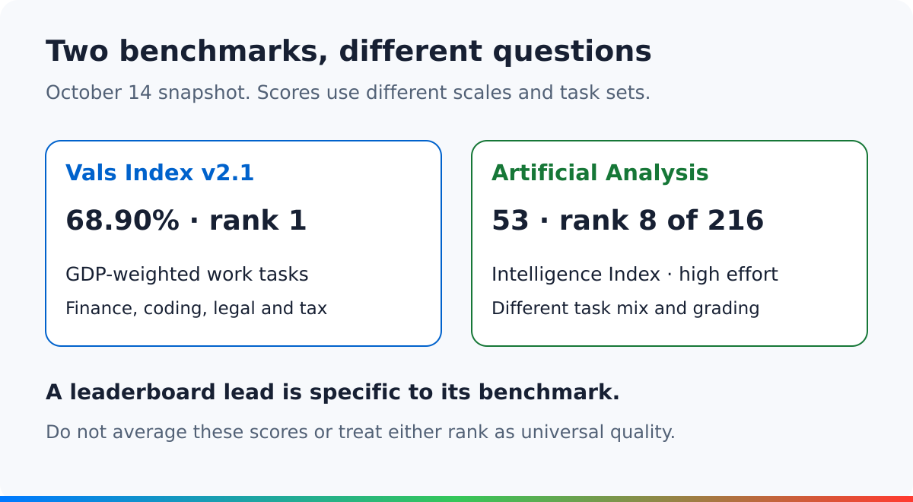

<figure style={{margin: "0 0 32px"}}>
<video controls playsInline preload="metadata" aria-label="Gemini 4 Argon: capabilities and early reception" poster="/posts/2026-10/gemini-4-argon-review/poster.jpg" style={{display: "block", width: "100%", height: "auto", aspectRatio: "16 / 9", borderRadius: "16px"}}>
  <source src="/posts/2026-10/gemini-4-argon-review/gemini-argon-review.mp4" type="video/mp4" />
  <track kind="subtitles" src="/posts/2026-10/gemini-4-argon-review/captions.en.vtt" srcLang="en" label="English" default />
  <track kind="subtitles" src="/posts/2026-10/gemini-4-argon-review/captions.zh-Hans.vtt" srcLang="zh-Hans" label="简体中文" />
  <track kind="subtitles" src="/posts/2026-10/gemini-4-argon-review/captions.zh-Hant.vtt" srcLang="zh-Hant" label="繁體中文" />
  <track kind="subtitles" src="/posts/2026-10/gemini-4-argon-review/captions.ja.vtt" srcLang="ja" label="日本語" />
  Your browser does not support embedded video. <a href="/posts/2026-10/gemini-4-argon-review/gemini-argon-review.mp4">Download the video</a>.
</video>
</figure>

Gemini 4 Argon is a serious new option for complex coding and reasoning. The evidence is less clear about whether it should replace your current model. Independent rankings differ, and early users report both useful results and familiar coding failures.

This distinction matters because the rollout is recent. Google [first introduced Argon](https://blog.google/innovation-and-ai/models-and-research/gemini-models/gemini-4-argon/) on September 30 with restricted access. Its October 13 [Gemini app announcement](https://blog.google/innovation-and-ai/products/gemini-app/gemini-4-argon-availability/) extended access to Google AI Pro and Ultra subscribers. The [API model page](https://ai.google.dev/gemini-api/docs/models/gemini-4-argon), updated October 13, lists `gemini-4-argon` as stable. The observations below are a snapshot from October 14, 2026.

## What Argon actually supports

Argon accepts text, images, video, audio, and PDF files, but produces text. Its listed tools include code execution, function calling, search grounding, and structured output. Computer use remains a preview. The model does not support image generation, audio generation, or the Live API. These details come from Google's [model specification](https://ai.google.dev/gemini-api/docs/models/gemini-4-argon).

That makes the model relevant to tasks that combine documents or media with reasoning. It does not make the API a complete agent product. The surrounding software still controls tools, permissions, retries, and storage.

The context limit needs particular care. Input, thinking, and output share 1,048,576 tokens. Default synchronous output stops at 65,536 tokens. Longer generation needs continuation, with background execution as the documented straightforward route. A million-token window is not a million input tokens plus a separate million-token answer. See the [developer guide](https://ai.google.dev/gemini-api/docs/latest-model).

## The independent scores do not tell one story

In [Vals Index v2.1](https://www.vals.ai/benchmarks/vals_index), updated October 13, Argon leads at 68.90%. Sonnet 5.5 follows at 67.04%, then Opus 5.5 at 66.97%. Vals combines finance, coding, legal, and tax tasks with economic weights. Its first-place result is evidence of strength on that mix of professional work.

[Artificial Analysis](https://artificialanalysis.ai/models/gemini-4-argon) reports a different picture: an Intelligence Index score of 53 at high reasoning effort, ranking eighth among 216 models in the checked snapshot. Its weighted cost per task is $1.99. That figure belongs to its evaluation setup, not to every API request.

The rankings are not contradictory measurements of one fixed property. They use different tasks, settings, and scoring rules. Together, they support calling Argon competitive. They do not support calling it the best model for every task.

## What mainstream coverage emphasizes

The major reports we checked focus on the launch, access, and benchmark claims. They should not be mistaken for a set of independent long-term product reviews.

| Publication | Date | Main emphasis |
| --- | --- | --- |
| [TechCrunch](https://techcrunch.com/2026/09/30/google-releases-gemini-4-argon-called-its-most-powerful-model-yet/) | September 30 | Cybersecurity shaped the restricted initial release. |
| [VentureBeat](https://venturebeat.com/technology/google-unveils-gemini-4-argon-retaking-benchmark-lead-over-openai-and-anthropic-but-in-limited-release) | September 30 | Strong enterprise benchmarks did not amount to a clean sweep. |
| [Axios](https://www.axios.com/2026/09/30/google-gemini-4) | September 30 | A catch-up opportunity whose value depends on developer experience. |
| [Reuters](https://www.investing.com/news/stock-market-news/google-announces-gemini-4-flagship-ai-model-after-months-of-delays-4925832) | September 30 | Restricted initial access; Google described a larger model than earlier Pro versions. |
| [Ars Technica](https://arstechnica.com/ai/2026/10/gemini-4-argon-begins-rolling-out-in-gemini-app-and-antigravity-but-only-if-you-pay/) | October 13 | Paid access and introductory API pricing shape the practical rollout. |

This coverage helps explain why Argon matters and who can use it. It provides less evidence about failure rates in everyday work. For that, the published engineering example and early user reports are more revealing, with different limits of their own.

## Google's coding example includes the failures

Google's [ADK Python case study](https://developers.googleblog.com/optimizing-a-200000-line-python-codebase-overnight-with-gemini-4-argon/) describes an 11-hour Antigravity run on a large existing repository. It proposed six optimizations; maintainers shipped two. Google reports faster session preparation and imports after review.

The revealing detail is the test gap. All 16,892 open-source tests passed, but 25 internal test targets failed after import changes. Review also rejected proposals that relied on fragile state, private library details, or gains limited to synthetic tests.

This is a Google-authored case study, not independent replication. Even so, its rejected work is useful evidence. Argon found changes worth shipping, while maintainers still had to protect compatibility and remove unsafe or unhelpful ideas.

For a development team, that suggests a concrete role: ask the agent to investigate and propose changes, while keeping merge authority with people who understand the system.

## Early social feedback is genuinely mixed

In an October 13 [Reddit feedback comment](https://www.reddit.com/r/GeminiAI/comments/1x50usi/comment/pgi9sl0/), u/AccomplishedChip3494 praised speed and the discovery of security edge cases. The same commenter warned about heavy token use at high reasoning effort and described medium effort as a promising compromise. These are early personal impressions, not measured performance guarantees.

A separate [Antigravity review thread](https://www.reddit.com/r/google_antigravity/comments/1x539fq/gemini_4_argon_initial_review/) gives a less favorable coding account. Its author, u/this-is-hilarours, reported architectural mistakes in a Python implementation plan, which Argon revised after feedback. The comparison used one task and another model as a judge. Replies challenged that method, and the author acknowledged the limited sample.

A more enthusiastic [r/singularity comment](https://www.reddit.com/r/singularity/comments/1x53r9g/comment/pgj9xmj/) from u/LoveMind_AI described better use of accumulated project context during long-running agent work. It did not provide a standardized task set. That makes it a useful account of what impressed one user, rather than proof of a general advantage.

The reports identify useful strengths and recognizable failure modes, but none establishes how often those results occur. The thread's numerical grades are therefore less useful than the description of the actual mistakes.

Social posts also mix API behavior with the behavior of products such as Antigravity. A complaint about context compaction or a subscription quota cannot, by itself, establish the raw model's context limit or token price.

## Cost and access can change the decision

Google's [standard API pricing](https://ai.google.dev/gemini-api/docs/pricing) is introductory: $2 per million input tokens and $10 per million output tokens through November 30. From December 1, those rates become $4 and $20. Output billing includes thinking tokens; additional tool charges can apply.

| Standard API usage | Through November 30, 2026 | From December 1, 2026 |
| --- | --- | --- |
| One million input tokens | US$2 | US$4 |
| One million output tokens, including thinking | US$10 | US$20 |

The advertised per-token price is only one part of the bill. A model that thinks longer, repeats work, or needs more corrections can cost more per finished task. Google's guide offers low, medium, and high thinking levels, with medium as the default. Start there unless the task justifies more reasoning.

Keep the access routes separate. Pro and Ultra subscribers can use Argon in the Gemini app. In the AI Studio web interface, [subscription access to Argon requires Ultra](https://ai.google.dev/gemini-api/docs/google-ai-plans). Direct API usage is billed separately. An app subscription therefore does not establish API access or an included API budget.

## Conclusion

Argon deserves a place on the shortlist for difficult reasoning, document analysis, and coding investigation. Its independent results are strong, but the rankings and early reports do not establish a universal winner.

For coding, use its proposals with review rather than treating a successful run as a finished change. For cost, compare completed work at the intended reasoning level and include the December price increase. The useful question is where Argon improves your work, not whether one launch score settles the whole comparison.
