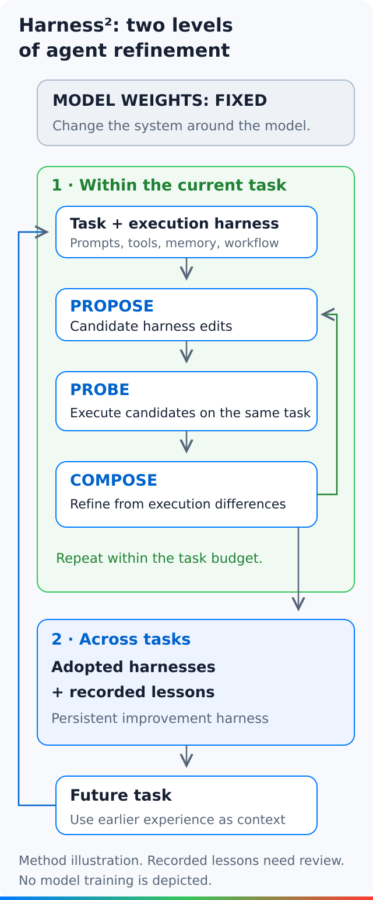

<figure style={{margin: "0 0 32px"}}>
<video controls playsInline preload="metadata" aria-label="Harness squared: two loops for improving an agent harness" poster="/posts/2026-10/harness2-recursive-agents/poster.jpg" style={{display: "block", width: "100%", height: "auto", aspectRatio: "16 / 9", borderRadius: "16px"}}>
  <source src="/posts/2026-10/harness2-recursive-agents/harness2-recursive-agents-v2.mp4" type="video/mp4" />
  <track kind="subtitles" src="/posts/2026-10/harness2-recursive-agents/captions.en.vtt" srcLang="en" label="English" default />
  <track kind="subtitles" src="/posts/2026-10/harness2-recursive-agents/captions.zh-Hans.vtt" srcLang="zh-Hans" label="简体中文" />
  <track kind="subtitles" src="/posts/2026-10/harness2-recursive-agents/captions.zh-Hant.vtt" srcLang="zh-Hant" label="繁體中文" />
  <track kind="subtitles" src="/posts/2026-10/harness2-recursive-agents/captions.ja.vtt" srcLang="ja" label="日本語" />
  Your browser does not support embedded video.
</video>
</figure>

An agent can use a capable model and still follow a poor workflow. It may call the wrong tool, omit a useful check, or repeat an unsuccessful approach. Changing the model is only one possible response.

[Harness²](https://github.com/google-research/harness2), an open-source research project from Google Research, targets the system around the model. It changes the agent's harness while keeping model weights fixed. The main idea is to test changes on the task in front of the agent, then retain useful experience for later tasks.

This is an October research release, not a new model or a supported Google product. Its [initial release commit](https://github.com/google-research/harness2/commit/e0fb65029feecd7f786ddd5b648c6f54aae7d86d) is dated October 8. The [paper](https://arxiv.org/abs/2610.14224) was submitted on October 9. We inspected package version 0.1.0 at commit `1cfe254e8d25b15f37048c3730134686abe60335`.

## What is a harness?

A harness connects a model to the machinery it needs to act. It supplies instructions, exposes tools, manages context and coordinates work. Two agents can use the same model yet behave differently because their harnesses differ.

Harness² exposes eight editable components. The [repository's component model](https://github.com/google-research/harness2/blob/1cfe254e8d25b15f37048c3730134686abe60335/README.md#harness-components) groups their roles around context, tools and execution.

| Component | What a change can affect |
| --- | --- |
| System prompt | The agent's working instructions |
| Guardrails | Rules represented inside the harness |
| Memory | Context carried into the task |
| Tool guidance | How the agent is told to use tools |
| Subagents | Delegated work and coordination |
| Skills | Reusable task instructions |
| Scripts | Executable support code |
| Plugins | Behavior within the execution loop |

These are editable research surfaces, not a reason to let an agent remove its own external safety controls. Keep host permissions, credentials and network policy outside the changes being tested.

## Two loops, with different jobs

The inner loop improves an execution harness for one task. The outer loop improves the process that will make those changes on future tasks.



The [animated two-loop diagram](./harness2-recursive-agents/request-flow-animated.svg) follows this sequence. Its static alternative preserves the same explanation without motion.

### Propose, probe, compose

First, propose changes to the harness. Candidates can address general working behavior or the task's domain.

Next, execute those candidates on the same task. The resulting traces and deliverables provide concrete differences to examine. A proposed change is not useful merely because its wording sounds better.

Then compose a refined harness from that evidence. This is more than selecting a prompt before execution: the method uses contrasts between runs to guide the next configuration.

The paper describes this task-time process without ground-truth feedback. That does not mean it operates without evidence. It uses the task, execution behavior and generated deliverables. External benchmark evaluation is a separate stage.

### Retain experience for the next task

After adoption, a reflection step stores the adopted harness and evidence-supported lessons in a domain-specific library. Later tasks in that domain can use earlier entries.

The [experiment guide](https://github.com/google-research/harness2/blob/1cfe254e8d25b15f37048c3730134686abe60335/docs/EXPERIMENTS.md) keeps tasks within a domain ordered. Different domains can run concurrently. Libraries are separated by benchmark, executor, recursion mode, budget and seed.

This outer loop changes the improvement context. It does not train new model weights, and it does not make every stored lesson universally correct.

## Wider search or deeper refinement?

Harness² supports two ways to spend the task-level recursion budget, `k`. Both start with `k` reference executions of the base harness.

| Mode | What `k` controls | Question to investigate |
| --- | --- | --- |
| Parallel | `k` general candidates, `k` domain candidates and `k` compositions | Which alternative changes produce useful evidence? |
| Sequential | `k` successive Propose–Probe–Compose steps | Does carrying a refinement forward improve the next step? |

A larger budget means more work. In model-backed runs, execution and improvement stages incur API costs. Compare modes with the same tasks, models and network conditions. The seed shuffles the task stream; it does not fix model sampling.

## What the local demo actually shows

We ran the [official local demo](https://github.com/google-research/harness2/blob/1cfe254e8d25b15f37048c3730134686abe60335/harness2/demo.py) with `k=2` in both modes. It uses two small transaction ledgers and real Python executions. The base script sums only positive amounts, so it omits the negative entries.

| Fixture | Base script total | Adopted script total | Change |
| --- | --- | --- | --- |
| Ledger 1: 100.25, −20.10, 5.00 | 105.25 | 85.15 | Includes the negative amount |
| Ledger 2: 35.50, −10.25, −5.00 | 35.50 | 20.25 | Includes both negative amounts |

Both tasks completed without failure. The run made 28 Python executions and 32 scripted editor, selector and reflection calls. Repeating the same command skipped both completed tasks, with no new executions or editor calls.

The important limitation is in the demo's source. The editor is programmed to remove the positive-only filter. The selector independently calculates the expected ledger sum. No language model discovers the repair, and this demo does use an exact expected answer to select a result.

It therefore demonstrates execution, comparison, adoption, stored lessons and resume behavior. It does not reproduce the paper's ground-truth-free model-backed method or establish its benchmark gains.

A positive-only control exposed another limit. Its output stayed at 105.25, but the scripted reflection still called the change helpful. That branch checks whether the code changed. It does not establish that the output improved. Stored lessons still need evidence checks.

The two modes also did not produce different solutions here. The parallel compositions were identical. In sequential mode, the second edit made no further change after the first repair. More recursion is not automatically more useful work.

### Try the same small run

We ran the pinned source on Linux with Python 3.12.14 through a small execution guard. It clears inherited environment settings and permits only the reviewed demo subprocesses. It invokes the unmodified official demo CLI; it does not replace the recursive algorithm.

Extract the [accompanying experiment archive](/posts/2026-10/harness2-recursive-agents/harness2-local-experiment-v1.zip), then run its tested command:

```sh
python3 -I -S -B safe_runner.py demo --output runs/demo --k 2
```

The archive includes the required pinned source, guard, fixtures, results and license notices. This route needs no package installation, model credentials or paid inference. Read its README for the guard's limits and the negative checks.

The project also documents a normal `uv` installation route in its [README](https://github.com/google-research/harness2/blob/1cfe254e8d25b15f37048c3730134686abe60335/README.md#install). We did not use that route for these measurements. Our guarded demo does not establish that the model-backed runners are isolated.

## What the paper reports

The [paper's Tables 1 and 2](https://arxiv.org/html/2610.14224v1) report gains after one refinement step. These are the authors' results, not measurements from our local demo.

| Benchmark and configuration | Base → Harness² | Reported gain |
| --- | --- | --- |
| WorkBuddy-Bench, GLM-5 / OpenCode | 64.2 → 75.7 | 11.5 macro-average score points |
| JobBench, Gemini 3.5 Flash / OpenCode | 31.5 → 36.0 | 4.5 score points |
| LAB, GLM-5 / OpenCode | 59.6 → 71.4 | 11.8 percentage points in Partial pass rate |

The LAB metric measures passed criteria, not the percentage of whole legal tasks completed successfully. The authors average over three shuffled task-stream runs. Their default editor is Claude Opus 4.8, so these results do not mean one model independently improves itself.

Extra executions and editing consume inference compute. Results also vary by configuration; Harness² does not lead every comparator in every setting. Treat the paper as evidence for a research approach, then evaluate costs and task quality on your own controlled workload.

## Before a model-backed run

The credential-free demo and the benchmark runners have very different operating requirements. The latter use an executor, an improvement model and a judge, plus benchmark-specific dependencies.

The [setup guide](https://github.com/google-research/harness2/blob/1cfe254e8d25b15f37048c3730134686abe60335/docs/SETUP.md) documents OpenCode and an optional Codex executor. We did not start either executor or call a model service.

Review the execution boundary before connecting real data. The release documentation says executor network access is unrestricted and its Codex configuration disables that executor's sandbox. Do not copy those settings into a trusted environment without separate controls.

Benchmark integrity also needs attention. The [web-access guidance](https://github.com/google-research/harness2/blob/1cfe254e8d25b15f37048c3730134686abe60335/docs/EXPERIMENTS.md#web-access) notes that public answers or grading criteria may be accessible online. It reports a validation rollout that downloaded a task rubric. That warning does not prove the paper's results are contaminated. It does show why reproduction needs a documented network policy.

Use a dedicated workspace, exclude secrets and limit the selected tasks. Review model costs before starting. Record the source commit, task selection, executor, model configuration, recursion budget and network restrictions with the results.

Harness² is licensed under Apache-2.0. Benchmarks, datasets and bundled third-party code retain their own terms. The repository explicitly says this is not an officially supported Google product.

The useful starting point is small: inspect an executed change and its evidence. Once that chain is clear, decide whether model-backed harness search is worth its cost for your own tasks.
