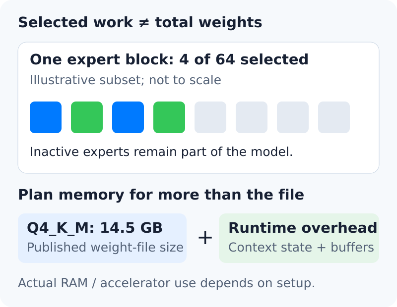
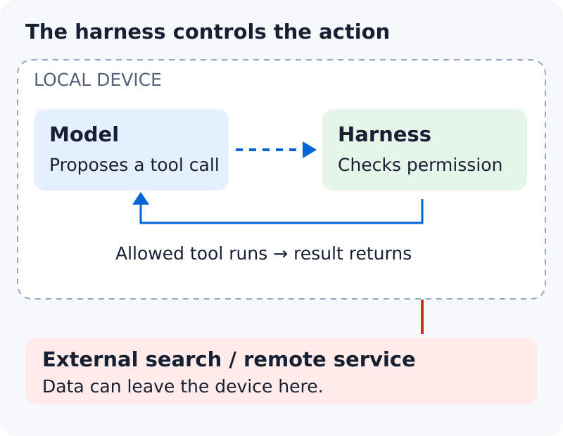

<figure style={{margin: "0 0 32px"}}>
<video controls playsInline preload="metadata" aria-label="LFM2.5-24B-A2B: memory, speed, and local-agent deployment" poster="/posts/2026-10/lfm25-local-agents/poster.jpg" style={{display: "block", width: "100%", height: "auto", aspectRatio: "16 / 9", borderRadius: "16px"}}>
  <source src="/posts/2026-10/lfm25-local-agents/lfm25-local-agents-v1.mp4" type="video/mp4" />
  <track kind="subtitles" src="/posts/2026-10/lfm25-local-agents/captions.en.vtt" srcLang="en" label="English" default />
  <track kind="subtitles" src="/posts/2026-10/lfm25-local-agents/captions.zh-Hans.vtt" srcLang="zh-Hans" label="简体中文" />
  <track kind="subtitles" src="/posts/2026-10/lfm25-local-agents/captions.zh-Hant.vtt" srcLang="zh-Hant" label="繁體中文" />
  <track kind="subtitles" src="/posts/2026-10/lfm25-local-agents/captions.ja.vtt" srcLang="ja" label="日本語" />
  Your browser does not support embedded video. <a href="/posts/2026-10/lfm25-local-agents/lfm25-local-agents-v1.mp4">Download the video</a>.
</video>
</figure>

A model can use few parameters for each token and still need substantial memory. That distinction is central to LFM2.5-24B-A2B, which Liquid AI [released on October 13](https://www.liquid.ai/blog/lfm2-5-24b-a2b). It targets agents that reason and call tools on local hardware.

The release deserves attention because it offers another route to local automation. But a fast model is only one part of a useful agent. Memory, task quality, tool access, and total completion time still decide whether the system fits.

## Active parameters are not the memory budget

The [model card](https://huggingface.co/LiquidAI/LFM2.5-24B-A2B) lists 24.0 billion total parameters and 2.45 billion active parameters per token. A mixture-of-experts model selects part of its expert network for each token. In this model, each expert block selects four of 64 experts. The other weights do not disappear when they are inactive.

The [official GGUF files](https://huggingface.co/LiquidAI/LFM2.5-24B-A2B-GGUF/tree/main) make the storage requirement concrete. As checked on October 15, Q4_K_M is listed at 14.5 GB; Q8_0 is 25.5 GB. These are weight-file sizes, not measured runtime memory requirements. The runtime also needs space for context state, working buffers, and other software. The split between system and accelerator memory depends on the backend and configuration.

The practical implication is simple: do not choose a machine from the rounded “2B active” label. Start with the exact weight format, then leave room for the runtime and the context you will use. We did not run model inference for this article; these sizes describe published files, not measured runtime use.

## Three different meanings of fast

The [model card](https://huggingface.co/LiquidAI/LFM2.5-24B-A2B) reports 184 generated tokens per second on an Apple M5 Max with llama.cpp, Q4_K_M, and a 4K-token input. Liquid’s separate [B300 result](https://www.liquid.ai/blog/lfm2-5-24b-a2b) exceeds 21,000 output tokens per second across concurrent requests. The GPU test uses SGLang 0.5.22, BF16 weights, 1,024 input tokens, and up to 256 output tokens.

Those figures answer different questions:

| Measure | What it tells you | What it leaves out |
| --- | --- | --- |
| Decode speed | How quickly one output stream grows | Prompt processing and tool delays |
| Aggregate throughput | How much a busy server produces | Delay for one user's request |
| Task completion time | How long the useful result takes | Quality, unless you check the result too |

A reasoning model can generate more tokens before it acts. An agent can also wait for search, a test suite, or a retry. Faster decoding helps, but it does not establish faster completion. Measure the whole task with the same tools and limits when comparing systems.

## The benchmark picture is mixed

Liquid's [published comparison](https://huggingface.co/blog/LiquidAI/lfm25-24b-a2b) reports LiveClaw scores of 48.09 for LFM2.5-24B-A2B and 38.19 for Qwen3.6-35B-A3B. On SWE-Bench Verified with OpenCode, the order reverses: 51.00 and 66.20. Liquid ran the compared models with vLLM and benchmark-specific settings.

These are vendor measurements. They support a task-specific reading: strength in one tool benchmark does not imply stronger repository repair. We found no high-quality independent reproduction in the sources checked by October 15. [GIGAZINE’s October 14 coverage](https://gigazine.net/news/20261014-lfm2-5-24b-a2b/) also draws on Liquid’s results, rather than a new test.

For a coding workflow, the weaker repair result deserves attention. For a structured tool workflow, the tool results justify a closer look. Neither result removes the need to check the tasks that matter to your application.

## Local inference still needs a controlled tool loop

Liquid's [local-agent guide](https://docs.liquid.ai/examples/agent-harnesses) connects a local model server to an agent harness through an OpenAI-compatible endpoint. The harness is the software that manages tool calls and the task loop. The guide covers Hermes, OpenClaw, and Pi, but its default model examples use the smaller LFM2.5-2.6B. Check the model identifier, context settings, and tool parser before copying a setup.

Early [local-user reports](https://www.reddit.com/r/LocalLLaMA/comments/1x52kco/liquidailfm2524ba2b/) are mixed: some describe useful search calls, while others report malformed tool requests. The workloads and software differ. These anecdotes reinforce the need to check integration; they do not establish a general success or failure rate.

Local inference keeps the model computation on your machine. It does not, by itself, keep every tool request there. A search tool or remote service can transmit data outside the device. Give the agent only the files and tools it needs. Require confirmation for consequential writes, and keep a record of actions and failures.

The weights use the [LFM Open License v1.0](https://www.liquid.ai/lfm-license), which includes revenue-based restrictions on commercial use. It is not the standard Apache 2.0 license. Check the full terms and commercial licensing requirements before deployment.

## Conclusion

LFM2.5-24B-A2B is worth considering when local tool use matters and your hardware can hold the chosen weights with room to spare. Its active parameter count explains part of its compute cost, not its memory needs. Use the reported benchmarks to choose relevant trials, then compare completed tasks, delays, and tool permissions. The right local agent is the system that fits your workload, not the one with the largest tokens-per-second headline.
