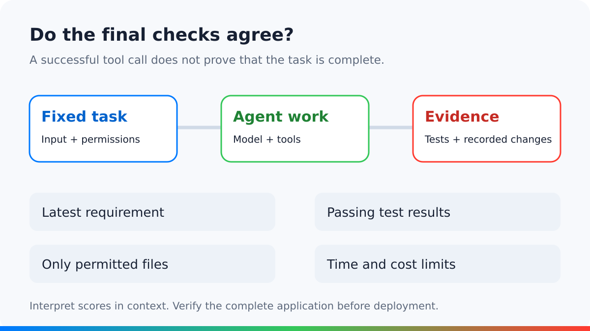

<figure style={{margin: "0 0 32px"}}>
<video controls playsInline preload="metadata" aria-label="Muse Wonder: long-task evaluation overview" poster="/posts/2026-10/muse-wonder-long-tasks/poster.jpg?v=3" style={{display: "block", width: "100%", height: "auto", aspectRatio: "16 / 9", borderRadius: "16px"}}>
  <source src="/posts/2026-10/muse-wonder-long-tasks/muse-wonder-review-v3.mp4" type="video/mp4" />
  <track kind="subtitles" src="/posts/2026-10/muse-wonder-long-tasks/captions.en.vtt?v=3" srcLang="en" label="English" default />
  <track kind="subtitles" src="/posts/2026-10/muse-wonder-long-tasks/captions.zh-Hans.vtt?v=3" srcLang="zh-Hans" label="简体中文" />
  <track kind="subtitles" src="/posts/2026-10/muse-wonder-long-tasks/captions.zh-Hant.vtt?v=3" srcLang="zh-Hant" label="繁體中文" />
  <track kind="subtitles" src="/posts/2026-10/muse-wonder-long-tasks/captions.ja.vtt?v=3" srcLang="ja" label="日本語" />
  Your browser does not support embedded video. <a href="/posts/2026-10/muse-wonder-long-tasks/muse-wonder-review-v3.mp4">Download the video</a>.
</video>
</figure>

Meta released Muse Wonder and Muse Wonder Full on October 12, 2026. The launch emphasizes two capabilities: retaining useful context and continuing through difficult, changing tasks. Meta calls them Active Memory and Active Focus. See the [launch announcement](https://research.meta.ai/blog/muse-wonder).

For developers, the useful question is whether an agent finishes the right work under real constraints. That requires evidence about the complete system.

## First, identify the deployment

The API documentation identifies `muse-wonder-1.0`, a context window of 1,048,576 tokens, and preview status. It separates the inference API from Muse Code, the ready-made coding agent. See the [developer overview](https://dev.meta.ai/docs/overview).

The [model page](https://dev.meta.ai/models/muse-wonder) lists Muse Wonder at $4 per million input tokens and $20 per million output tokens. Muse Wonder Full is available through eligible Muse Code subscriptions. These are the published access conditions checked on October 14.

An API model supplies responses and tool requests. The surrounding application decides which tools exist, how commands run, and what happens after interruption. That application is often called the agent harness. Record both the model version and the harness version when comparing results.

## Read the score with its setup

As checked on October 14, Artificial Analysis lists Intelligence Index v4.3.2 scores for both models. At max reasoning effort, [Wonder scored 52](https://artificialanalysis.ai/models/muse-wonder) and [Wonder Full scored 56](https://artificialanalysis.ai/models/muse-wonder-full). These independent measurements provide useful context. A composite score still cannot predict success on a particular repository or business process.

Meta's [model card, pages 4–6](https://research.meta.ai/static/muse-wonder-model-card) separates controlled internal coding comparisons from externally reported results. Its SWE-Marathon row mixes agent products. The card explicitly warns that this is not a common-harness comparison. It also notes that shared internal settings may not suit every competitor equally.

A common harness controls some variables, but it can also favor models that work well with its prompts and tools. Product-level comparisons answer another question: how well does each configured system complete the task?

Use both views when possible. Keep the task set, time limit, permissions, and grading rules fixed. Report changes to tools or prompts. Otherwise, a better score can reflect a better surrounding system without showing how much the model contributed.

| Evidence | Useful for | Does not establish |
| --- | --- | --- |
| Published model score | Selecting candidates | Reliability on your task |
| Common-harness run | Comparing models in one setup | Every model's best possible result |
| Independently checked final state | Verifying task completion | Safety of unobserved actions |

## Separate recall from durable memory

MemoryBench uses conversations of 64,000–100,000 tokens, including distracting material and updated or conflicting facts. It grades answers with a model judge. That description appears on [page 5 of the model card](https://research.meta.ai/static/muse-wonder-model-card).

This tests an important ability: selecting the relevant fact from a long supplied conversation. It does not, by itself, establish that an application preserves the right fact after a process restart. Storage, retrieval, and the model's use of retrieved information each need a test.

A release deadline can change from Thursday to Friday. Finding Friday in the supplied conversation tests recall. Retrieving that change after a restart also depends on the application's storage and retrieval design. MemoryBench alone does not establish that second behavior.

## What the evidence means for developers

The API and Muse Code answer different deployment needs. API access lets you choose tools and application behavior. A Muse Code result includes the behavior of that configured product. Do not treat the two routes as interchangeable evidence.

A useful comparison records the exact model, reasoning setting, tools, permissions, and runtime. It also checks the final output against the latest requirements. A task that stops correctly for approval should not be confused with a task that silently fails.

## Measure the complete cost of completion

For a deployment trial, track successful tasks within budget, with failures and necessary human interventions reported alongside them. Include tool time, retries, and review time. Tokens per second describe only one part of the experience.

Test recovery deliberately. Interrupt a run after an edit, restore it, and check whether it repeats an action or loses an updated requirement. Use a sandbox and reversible tasks before granting wider access.

## Conclusion

Muse Wonder is worth evaluating for long tasks that depend on context recall and sustained work. Its published scores help identify a candidate, but they do not establish reliability in your application.

Choose the deployment route first: the API model and Muse Code are different systems. Then compare verified task completion, recovery, elapsed time, and total cost under the same constraints. Treat durable memory as an application capability that needs separate evidence.

